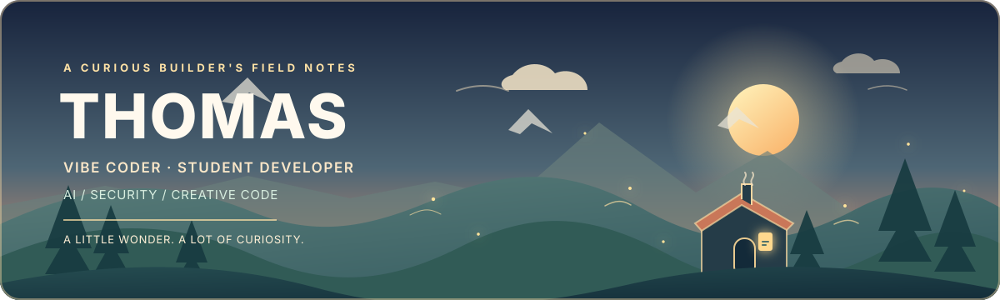

  
  
<strong>Turning curiosity into software — and asking how to make it safer.</strong> 
  会用 AI 把想法变成作品，也认真研究怎样让它们更安全。

## 👋 Hi, I'm Thomas

I'm a student developer and **vibe coder**: I use natural language to direct AI, shape the product, and turn ideas into software people can actually run. My path has taken me from Python and C++ to Java full-stack development and Unity; lately, I'm exploring AI agents and software security.

  
  

## 🌱 VibeGuard · Featured Project

<table>
  <tr>
    <td width="22%" align="center" valign="middle">
      
    </td>
    <td width="78%" valign="middle">
      <h3>A little guardian for AI-built code.</h3>
      
<strong>VibeGuard</strong> is a terminal security reviewer for vibe-coded projects. It checks a repository, explains risks with evidence, and suggests fixes you can inspect.

      
Read-only by default: review the proposed diff and approve it before VibeGuard writes anything. Local rules work without model calls; an optional AI review can investigate the checklist further.

      

        <a href="https://thomas-ai.space/vibeguard"><strong>Explore the project</strong></a> ·
        <a href="https://github.com/lindenthomaslin/vibeguard"><strong>Source code</strong></a> ·
        <a href="https://github.com/lindenthomaslin/vibeguard/blob/master/README.zh-CN.md"><strong>中文文档</strong></a>
      

      

        
        
        
      

    </td>
  </tr>
</table>

## 🔭 What I'm exploring

  
  
  

## 🧰 More open source

  
  

Security tools · LLM agent research · Small experiments with big questions

## 🚀 More Projects

- [Jarvis Assistant](https://github.com/lindenthomaslin/jarvis-assistant) — Iron Man inspired local voice assistant
- [PromptForge](https://github.com/lindenthomaslin/word-work) — AI prompt creation and refinement platform
- [Autumn Letter](https://github.com/lindenthomaslin/autumn-letter-visual-novel) — a visual novel set around school life

## 🧰 Things I Build With

  

## 📊 GitHub Stats

  
  

  <a href="https://thomas-ai.space/"><b>🌐 thomas-ai.space</b></a>
  &nbsp;·&nbsp;
  <a href="https://github.com/lindenthomaslin"><b>💻 GitHub</b></a>

  

