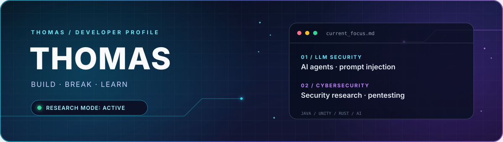
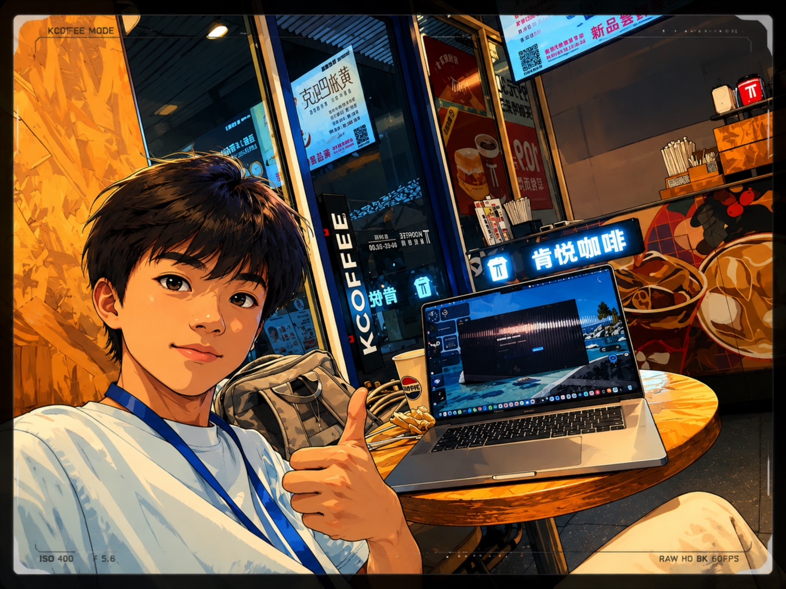

  

  

<table>
  <tr>
    <td width="38%" align="center" valign="middle">
      
    </td>
    <td width="62%" valign="middle">
      <h2>👋 Hi, I'm Thomas</h2>
      
I'm a student developer focused on <strong>Java full-stack development</strong> and <strong>Unity game clients</strong>.

      
I'm currently researching <strong>LLM security</strong>, especially <strong>AI agent security and prompt injection</strong>, while learning about <strong>cybersecurity and penetration testing</strong>.

      
I enjoy turning research questions and new ideas into runnable experiments, tools, and projects.

      

        
        
      

    </td>
  </tr>
</table>

## 🎯 Current Research

  
  
  

## ⚡ Featured Open Source

  
  

Security tooling · LLM agent research · Open source experiments

## 🚀 More Projects

- [Jarvis Assistant](https://github.com/lindenthomaslin/jarvis-assistant) — Iron Man inspired local voice assistant
- [PromptForge](https://github.com/lindenthomaslin/word-work) — AI prompt creation and refinement platform
- [Autumn Letter](https://github.com/lindenthomaslin/autumn-letter-visual-novel) — a visual novel set around school life

## 🧰 Things I Build With

  

## 📊 GitHub Stats

  
  

  <a href="https://thomas-ai.space/"><b>🌐 thomas-ai.space</b></a>
  &nbsp;·&nbsp;
  <a href="https://github.com/lindenthomaslin"><b>💻 GitHub</b></a>

  

